# Sequential Companion

**[▶ Open the app](https://shoogaze.github.io/sequential-companion/)**  ·  works in the browser, installs to the Home Screen

A single-file mobile web app that writes step-sequencer patterns for Digitakt 2 and other 16-step grooveboxes. It is the sister project of [Producer Companion](https://github.com/SHOOGAZE/producer-companion) and shares its look: Braun-notebook monochrome, one orange lamp, IBM Plex type, dot-matrix logo, glass LCD windows.

It does not play sounds from the patterns and it is not a sequencer. It makes a pattern card you read and punch into your own machine. The only sounds are the mechanical key clicks of the interface itself.

<!-- Demo: in the GitHub editor, drag extras/demo.mp4 here; it is uploaded and plays inline. -->

- **Library**: 164 hand-written presets across 28 genres (Techno, House, DnB, UKG, Hip-Hop, Trap, Electro, Latin, Ambient, Dub, Footwork, Kraut, Breaks, Trance, Synthwave, Afro, Dubstep, Jungle, Drill, Reggaeton, Disco, Gabber, Jersey, Trip-Hop, EBM, Amapiano, IDM, Dancehall), each with BPM, swing and a suggested key
- **Generator**: a seeded pattern engine with per-genre DNA. Density, chaos, trig conditions and parameter locks are sliders; the same seed always gives the same card
- **Variations**: every card comes as A, B and FILL (a snare roll into the next bar) from the same seed
- **Groove info**: micro-timing shift per track, polymeter track lengths (for example a 12-step perc against 16), probability conditions (`75%`, `50%`, `25%`) next to `1:2`, `3:4`, `NEI`, `PRE`, `!FILL`
- **MIDI export**: a 4-bar `.mid` file (A A B FILL), one MIDI channel per track, tempo, swing and micro-timing included. Conditions and parameter locks stay on the card, MIDI cannot carry them
- **Seed codes**: every card has a code like `DT2-CIKM5C`. Paste it on any device to get the same pattern back; −1 / +1 step through neighbours, Mutate nudges the card
- **Track locks**: pin a track (kick, snare, hats...) and it survives Roll and Mutate
- **Pattern card**: 8 tracks × 16 steps with ghost / normal / accent levels, trig conditions and parameter-lock markers, per-track counts and a plain-text version to copy
- **Share and print**: every card exports as a **PNG picture** (on a phone it opens the system Share sheet, so it goes straight to Telegram, Messages or AirDrop; on a desktop it downloads) and prints as a clean **one-page A4 card**. Variation tabs and folded sections are left out of the print. MIDI and copy-as-text are there too
- **Saved**: keep cards on the device and reload them later
- **Fidget**: triple-tap the logo for a step-pad toy with 16 trig keys, nothing else
- **Installable**: add to the Home Screen and it works offline (PWA)

Interface in RU / EN · light, grey and dark skins · two boot screens (a dot-matrix grid that writes a pattern and folds into the app, and a rarer card printer that prints the card line by line; force one with `?bv=mx` or `?bv=pr`) · generation animations that erase and write the pattern step by step · phone, tablet and desktop layouts.

Keys: `1` `2` `3` switch Library / Generator / Saved, `G` or `Space` generate, `←` `→` step through presets or seeds, `A` `B` `F` variations, `S` save, `E` MIDI, `C` copy, `M` toggle sound.

## Screenshots

| Boot: matrix | Boot: card printer | Library | Generator |
|---|---|---|---|
| 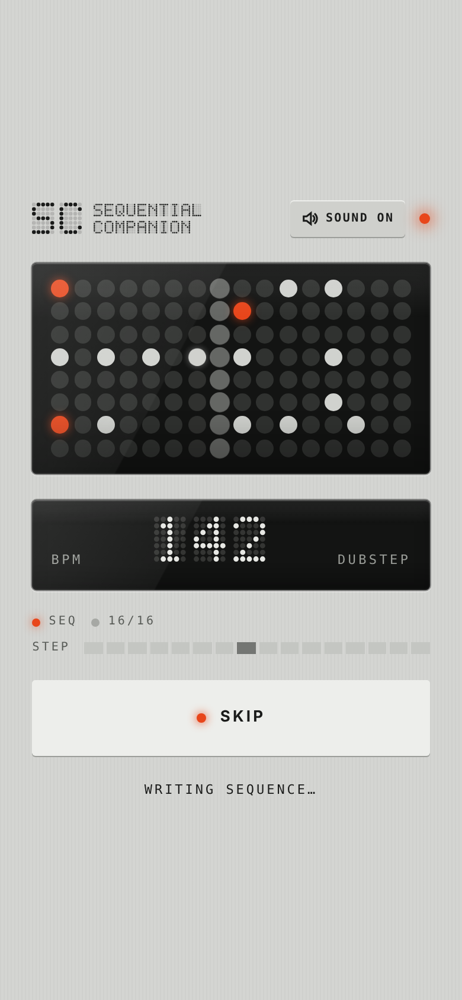 | 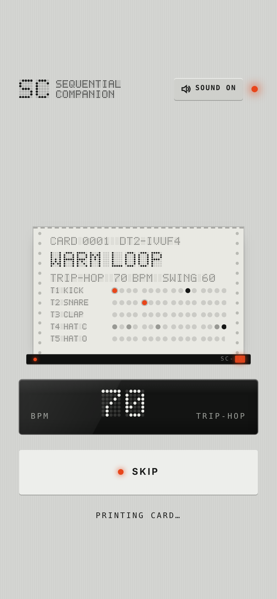 | 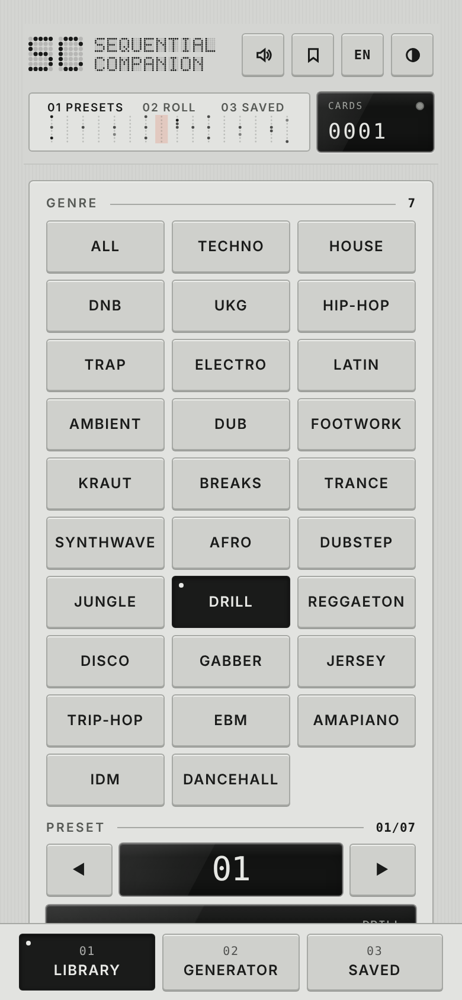 | 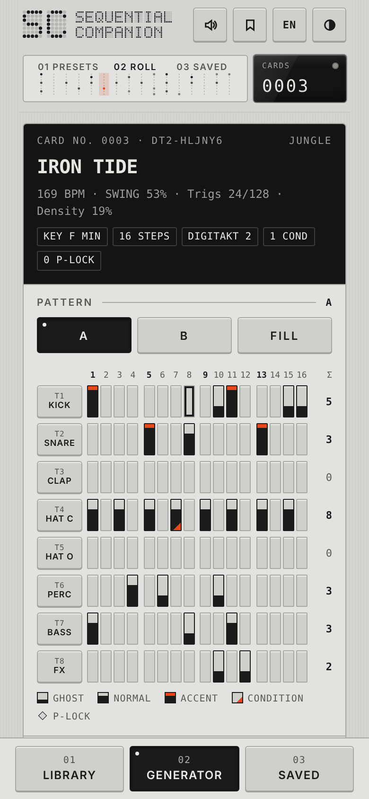 |

| Variations | Groove and MIDI | Dark skin | Saved |
|---|---|---|---|
| 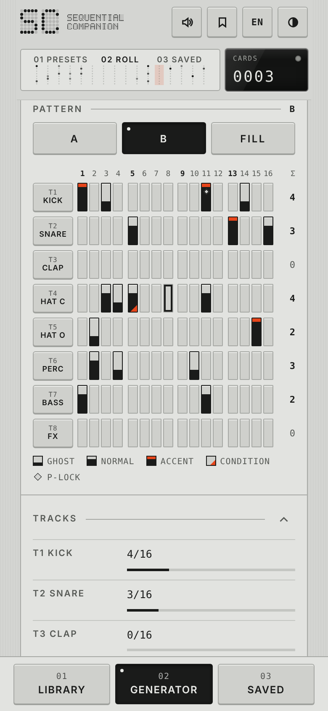 | 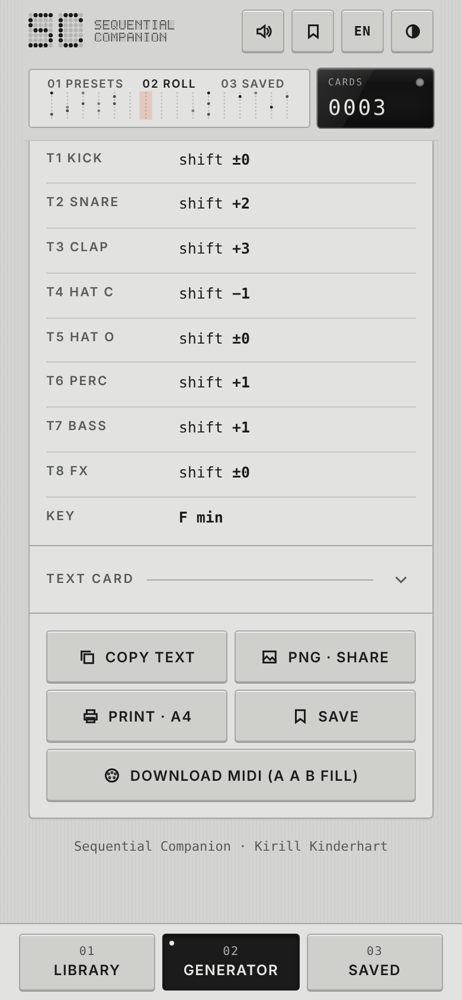 | 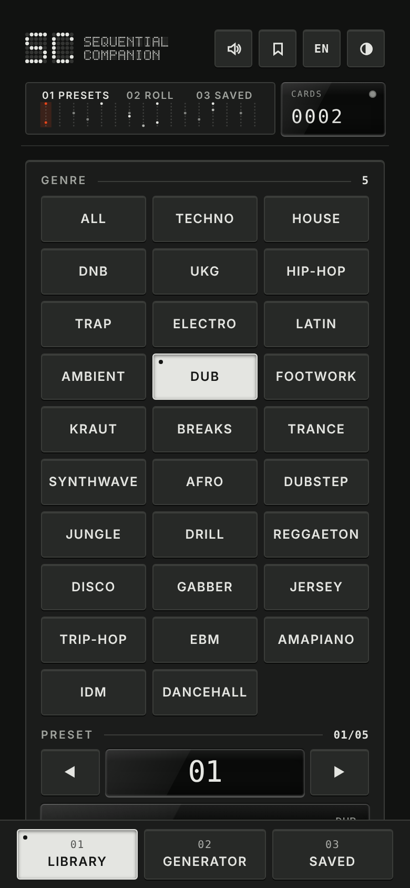 | 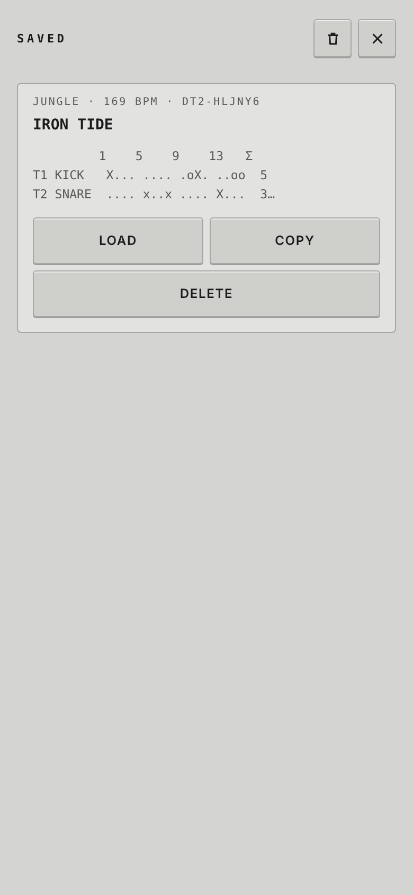 |

| Fidget |
|---|
| 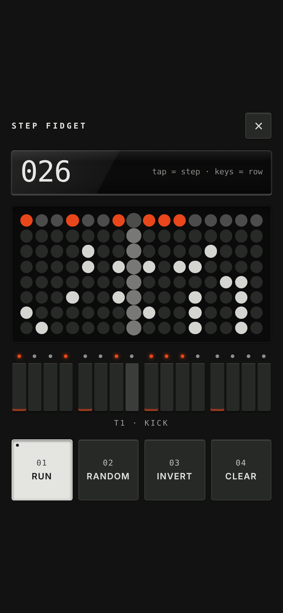 |

**Share as a picture and print on A4**

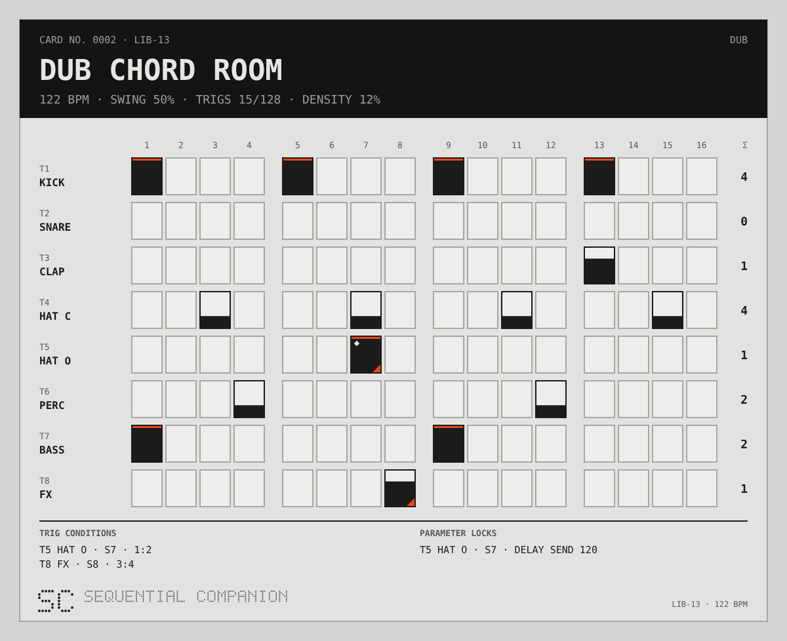

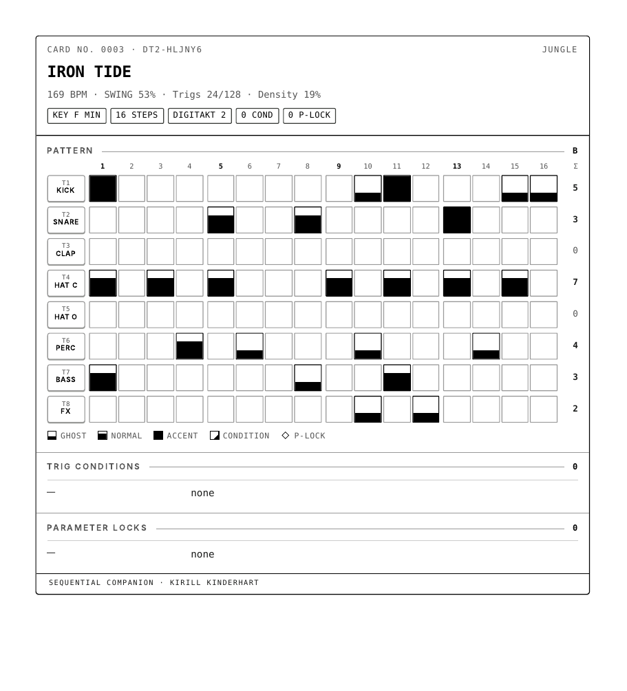

**Desktop and tablet**

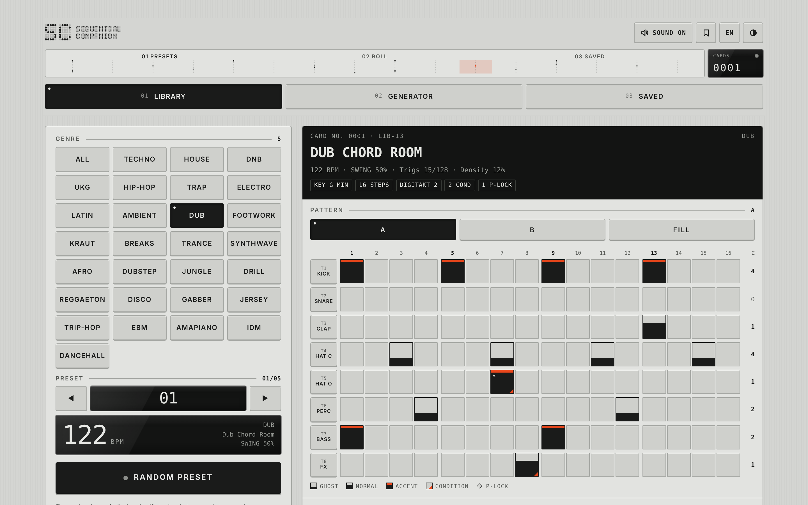

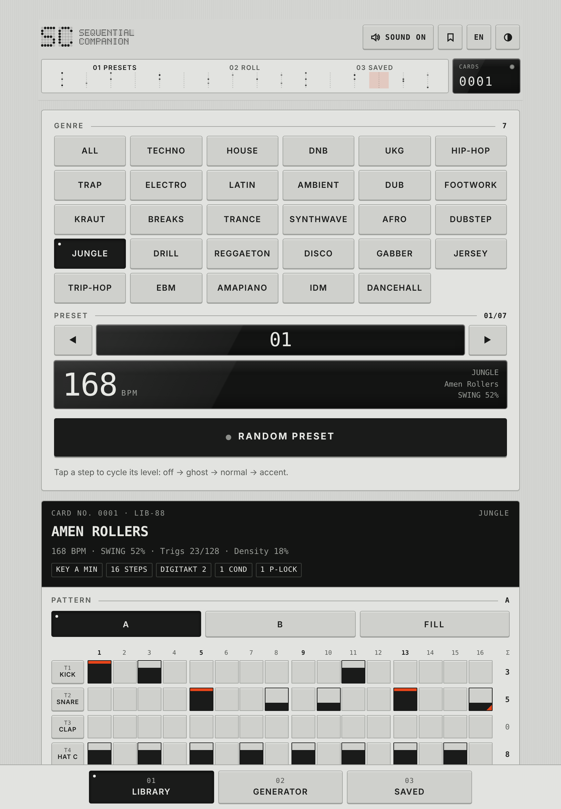

## Run

Live build: https://shoogaze.github.io/sequential-companion/

Open `index.html` in a browser. No build step. For GitHub Pages: Settings → Pages → deploy from branch `main`, root.

**Install on iPhone:** open the site in Safari → Share → Add to Home Screen. It then runs full-screen and offline. Keep `manifest.webmanifest`, `sw.js` and the `icons/` folder next to `index.html`.

## Companion project

**[Patch Companion](https://github.com/SHOOGAZE/patch-companion)** ([live](https://shoogaze.github.io/patch-companion/)) is the third app of the family: patch cards for 50 hardware synths, knob positions 0–10, by sound type and mood. The footer links all three and carries genre along.

[Producer Companion](https://github.com/SHOOGAZE/producer-companion) ([live](https://shoogaze.github.io/producer-companion/)) turns genre, tempo and mood into a track concept, names and album ideas. Use it to decide what the track is, then come here for the drum pattern to start it.

## License

[MIT](LICENSE) © 2026 Kirill Kinderhart
